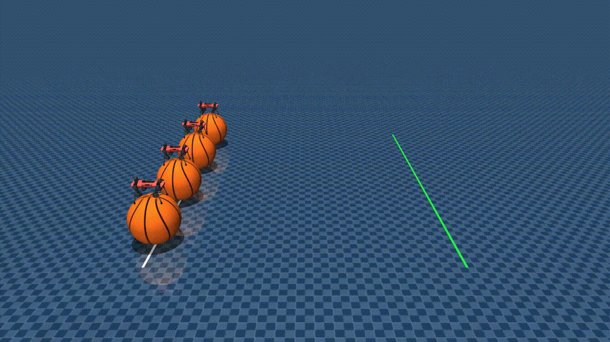

# ANYmal C Ball Balance



ANYmal C balancing on a ball, inspired by [Vottivott/microduck-playground](https://github.com/Vottivott/microduck-playground).

## Structure

```
src/anymal_c_ball_balance/
  __init__.py                        # Task registration (entry point)
  ball.py                            # Ball definition
  env_cfgs.py                        # Environment configs (sensors, rewards, terminations)
  mdp.py                             # Task-specific managers
  rl_cfg.py                          # RL hyperparameters (PPO)
  scripts/
    race.py
  assets/
    basketball/                      # Meshes and textures
```

## Usage

You can train a checkpoint using:

```sh
uv run train Mjlab-BallBalance-Anymal-C --env.scene.num-envs 4096 --agent.max-iterations 30_000
```

And you can run your trained checkpoint using one of:

```sh
# WandB
uv run play Mjlab-BallBalance-Anymal-C --wandb-run-path <wandb-run-path>

# Checkpoint file
uv run play Mjlab-BallBalance-Anymal-C --checkpoint-file /path/to/checkpoint.pt
```

This repo also contains a script to run several robots on their balls with a shared policy:

```sh
uv run race --checkpoints /path/to/checkpoint.pt \
    --num-envs 4 \
    --distance 10 \
    --speed 0.5
```

To compare different policies, provide one checkpoint per robot:

```sh
uv run race \
  --checkpoints /path/to/model_A.pt /path/to/model_B.pt /path/to/model_C.pt /path/to/model_D.pt \
  --num-envs 4 \
  --distance 10 \
  --speed 0.5
```

## Assets

* Ball: adapted from [Vottivott/microduck-playground](https://github.com/Vottivott/microduck-playground).
* ANYmal C: directly loaded from my [fork](https://github.com/IamPhytan/anymal_c_velocity) of [mujocolab/anymal_c_velocity](https://github.com/mujocolab/anymal_c_velocity).
